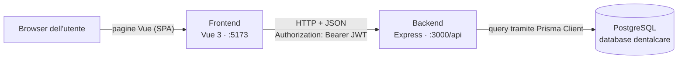
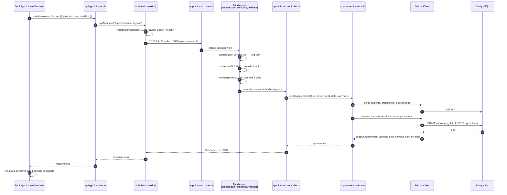
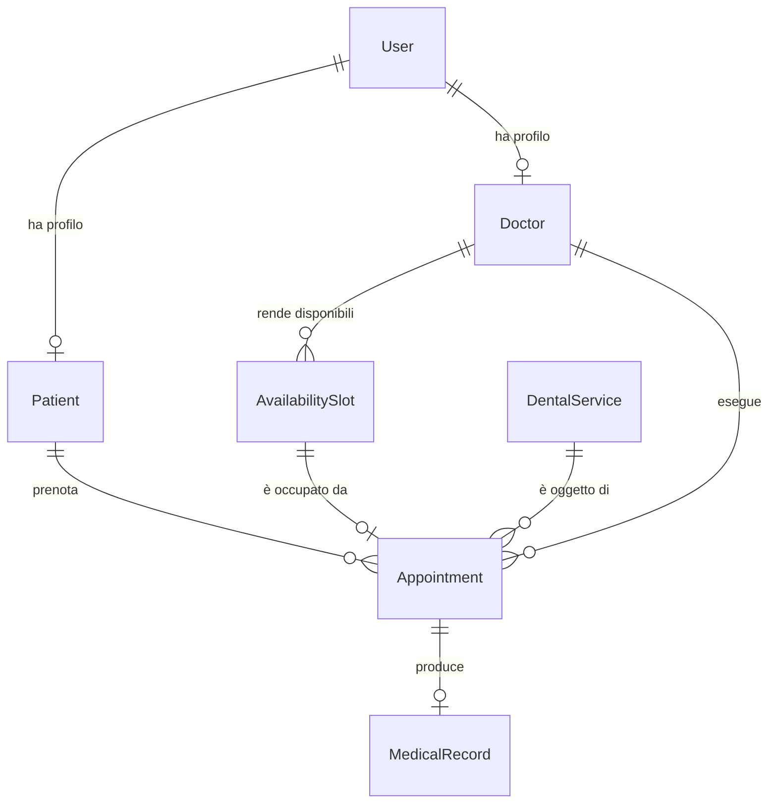
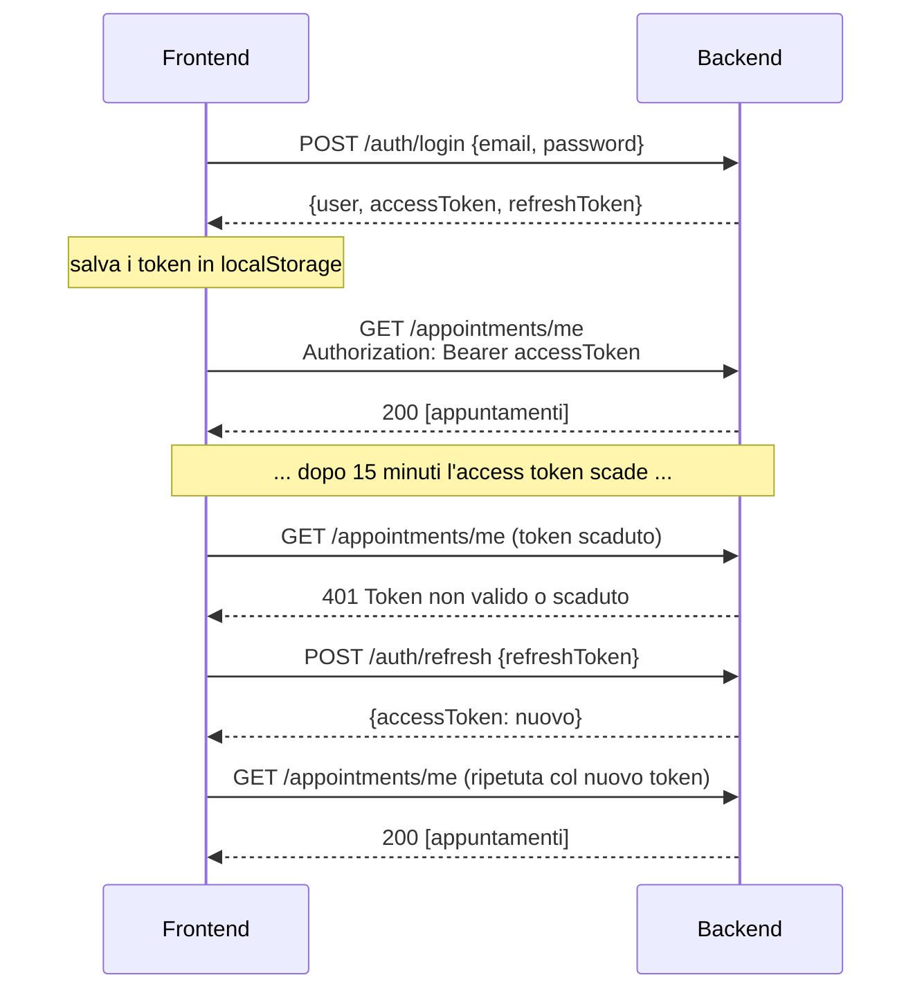
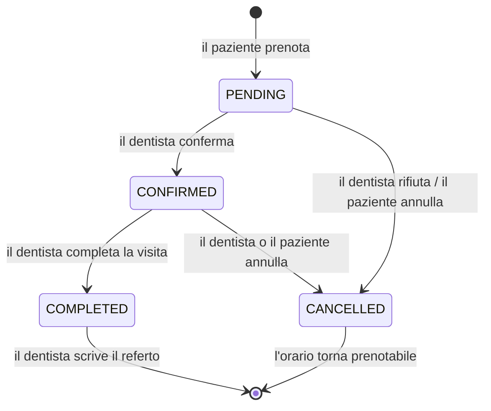

# DentalCare — Documentazione tecnica

Questo documento spiega **come è costruita e come funziona** l'applicazione DentalCare: il database, il backend, il frontend e soprattutto **come sono collegati tra loro**. Non descrive ogni singolo file riga per riga: spiega **cosa fa ogni tipologia di file** (es. "tutti i file `*.routes.ts` fanno questo"), approfondendo i punti in cui sta la logica importante.

Per installazione e avvio vedi il [README](../README.md#avvio-del-progetto).

## Indice

1. [Visione d'insieme](#1-visione-dinsieme)
2. [Il viaggio di una richiesta: dal click al database e ritorno](#2-il-viaggio-di-una-richiesta-dal-click-al-database-e-ritorno)
3. [Database (PostgreSQL + Prisma)](#3-database-postgresql--prisma)
4. [Backend (Express + TypeScript)](#4-backend-express--typescript)
5. [Catalogo delle API](#5-catalogo-delle-api)
6. [Frontend (Vue 3 + TypeScript)](#6-frontend-vue-3--typescript)
7. [Flussi completi, passo per passo](#7-flussi-completi-passo-per-passo)
8. [Sicurezza: chi può fare cosa](#8-sicurezza-chi-può-fare-cosa)
9. [Script e strumenti di supporto](#9-script-e-strumenti-di-supporto)
10. [Note tecniche e osservazioni](#10-note-tecniche-e-osservazioni)

---

## 1. Visione d'insieme

L'applicazione è composta da **tre strati** separati che comunicano in catena:



| Strato | Tecnologia | Cartella | Responsabilità |
| --- | --- | --- | --- |
| **Frontend** | Vue 3, Vite, Pinia, Vue Router, Axios | `frontend/` | Mostra le pagine, raccoglie l'input dell'utente, chiama le API, gestisce la sessione nel browser |
| **Backend** | Node.js, Express 5, Zod, JWT, bcrypt | `backend/` | Espone le API REST, verifica identità e permessi, valida i dati, applica le regole di business |
| **Database** | PostgreSQL + Prisma ORM | `backend/prisma/` | Conserva in modo persistente utenti, dentisti, prestazioni, slot, appuntamenti, referti |

Principi chiave:

- **Il frontend non parla mai direttamente con il database.** Passa sempre dal backend.
- **Il backend non genera pagine HTML**: risponde solo con JSON. Per questo è "API-based": lo stesso backend potrebbe servire un'app mobile.
- **Il backend è l'unica autorità sulla sicurezza.** I controlli nel frontend (rotte nascoste, bottoni non mostrati) servono solo a migliorare l'esperienza utente; i permessi veri sono verificati sul server a ogni richiesta.

---

## 2. Il viaggio di una richiesta: dal click al database e ritorno

Prima di entrare nel dettaglio dei singoli strati, conviene vedere **un esempio completo**. Prendiamo il caso più importante: un paziente prenota una visita.



Ogni strato ha **un solo compito**:

| # | File | Compito |
| --- | --- | --- |
| 1 | `views/*.vue` | Interfaccia: raccoglie i dati dal form e mostra il risultato |
| 2 | `api/*.ts` (frontend) | Traduce un'azione ("prenota") in una chiamata HTTP precisa |
| 3 | `api/client.ts` | Aggiunge il token, gestisce il rinnovo automatico, normalizza gli errori |
| 4 | `routes/*.routes.ts` | Associa URL + metodo HTTP alla catena di middleware e al controller |
| 5 | `middleware/*.ts` | Controlli trasversali: chi sei, che ruolo hai, i dati sono validi? |
| 6 | `controllers/*.controller.ts` | Legge la richiesta HTTP, chiama il service, sceglie lo status code della risposta |
| 7 | `services/*.service.ts` | Regole di business e accesso al database |
| 8 | Prisma Client | Traduce le chiamate TypeScript in query SQL |
| 9 | PostgreSQL | Salva e restituisce i dati |

Questo schema si ripete identico per **tutte** le funzionalità: login, gestione slot, referti, ecc.

---

## 3. Database (PostgreSQL + Prisma)

### 3.1 Cos'è Prisma e perché si usa

**Prisma** è un ORM (Object-Relational Mapper): permette di definire le tabelle in un file dichiarativo (`schema.prisma`) e di interrogare il database con funzioni TypeScript tipizzate invece di scrivere SQL a mano. Per esempio:

```ts
prisma.appointment.findMany({ where: { patientId: 5 }, include: { service: true } });
```

diventa una `SELECT` sulla tabella `Appointment` con una `JOIN` su `DentalService`. Il risultato è già un oggetto TypeScript con i tipi corretti.

### 3.2 File coinvolti

| File | Cosa fa |
| --- | --- |
| `backend/prisma/schema.prisma` | **Definizione del modello dati**: tabelle (`model`), colonne, tipi, relazioni, vincoli, enum. È la "fonte di verità" della struttura del database |
| `backend/prisma/migrations/*/migration.sql` | **Storico delle modifiche** al database, in SQL. Ogni cartella è una migrazione generata da Prisma quando lo schema è cambiato. `prisma migrate deploy` le applica in ordine |
| `backend/prisma/migrations/migration_lock.toml` | Indica il database usato (PostgreSQL); serve a Prisma per coerenza |
| `backend/prisma.config.ts` | Configurazione della CLI di Prisma: dove si trovano schema e migrazioni e da quale variabile leggere l'URL del database (`DATABASE_URL`) |
| `backend/src/config/prisma.ts` | Crea **un'unica istanza** di `PrismaClient`, condivisa da tutto il backend. Ogni service la importa con `import { prisma } from '../config/prisma'` |

Migrazioni presenti:

| Migrazione | Contenuto |
| --- | --- |
| `20260608173847_init` | Creazione iniziale di tutte le tabelle |
| `20260723185758_enforce_unique_appointment_slot` | Rende `Appointment.slotId` univoco: **uno slot può avere al massimo un appuntamento** (protezione contro le doppie prenotazioni anche a livello di database) |
| `20260905152424_add_profile_fields_and_is_active` | Aggiunge campi di profilo e i flag `isActive` per disattivare dentisti e prestazioni senza cancellarli |
| `20261003120000_repair_cancelled_appointment_slots` | Migrazione di **soli dati**: riallinea gli slot degli appuntamenti annullati con la versione precedente del codice (vedi §10) |

### 3.3 Il modello dati



**Enum**

- `Role`: `PATIENT`, `DOCTOR`, `ADMIN`: il ruolo di un account.
- `AppointmentStatus`: `PENDING` (in attesa), `CONFIRMED` (confermato), `COMPLETED` (completato), `CANCELLED` (annullato).

**Modelli**

| Modello | Scopo | Campi principali | Note |
| --- | --- | --- | --- |
| `User` | Account di accesso, comune a tutti i ruoli | `email` (univoca), `passwordHash`, `role` | La password non è mai salvata in chiaro, solo l'hash bcrypt |
| `Patient` | Profilo anagrafico del paziente | `firstName`, `lastName`, `codiceFiscale` (univoco), `dateOfBirth`, `phone`, `userId` | Relazione 1:1 con `User` (`userId` univoco). Se si cancella lo User, il profilo viene cancellato (`onDelete: Cascade`) |
| `Doctor` | Profilo del dentista | `firstName`, `lastName`, `specialization`, `bio`, `isActive`, `userId` | 1:1 con `User`. `isActive = false` lo esclude da prenotazioni e liste pubbliche |
| `DentalService` | Prestazione offerta (catalogo) | `name` (univoco), `description`, `durationMin`, `price` (`Decimal(10,2)`), `isActive` | La durata serve a capire quali slot sono abbastanza lunghi |
| `AvailabilitySlot` | Fascia oraria in cui un dentista è disponibile | `doctorId`, `date`, `startTime`, `endTime`, `isBooked` | Indice su `(doctorId, date)` per ricerche veloci. `isBooked` diventa `true` quando viene prenotato |
| `Appointment` | Prenotazione | `patientId`, `doctorId`, `serviceId`, `slotId` (univoco), `status` | Collega le quattro entità. Non si può cancellare una prestazione o uno slot usati da un appuntamento (`onDelete: Restrict`) |
| `MedicalRecord` | Referto della visita | `appointmentId` (univoco), `diagnosis`, `treatment`, `notes` | 1:1 con `Appointment`: al massimo un referto per visita |

Tutti i modelli hanno `id` autoincrementale e i timestamp `createdAt` / `updatedAt` gestiti automaticamente da Prisma.

**Perché `User` è separato da `Patient`/`Doctor`?** L'autenticazione (email, password, ruolo) è uguale per tutti, mentre i dati anagrafici cambiano per ruolo. Così il login funziona allo stesso modo per tutti e ogni profilo ha solo i campi che gli servono. Un `ADMIN` è semplicemente uno `User` con `role = ADMIN`.

### 3.4 Come il backend usa il database

Solo i file in `backend/src/services/` (più `user.controller.ts`, unica eccezione) parlano con Prisma. Le operazioni usate sono:

| Operazione Prisma | Uso nel progetto |
| --- | --- |
| `findUnique` | Cercare per chiave univoca (id, email, codice fiscale, userId) |
| `findMany` / `findFirst` | Elenchi con filtri e ordinamento; ricerca di sovrapposizioni tra slot |
| `create` (anche annidato) | Creare uno `User` **insieme** al suo `Patient` o `Doctor` in un'unica operazione |
| `update` / `updateMany` | Modificare dati; `updateMany` con condizione serve al "lock ottimistico" sugli slot (vedi §4.6) |
| `delete` | Eliminare uno slot libero |
| `include` / `select` | Decidere quali relazioni e campi restituire (es. includere il dentista ma solo `id` ed `email` del suo User, mai la password) |
| `$transaction` | Eseguire più operazioni "tutte o nessuna" (prenotazione, cancellazione) |

---

## 4. Backend (Express + TypeScript)

### 4.1 Struttura delle cartelle

```
backend/
├── src/
│   ├── app.ts              # punto di ingresso: crea il server Express
│   ├── config/             # configurazioni condivise (Prisma, Swagger)
│   ├── middleware/         # funzioni eseguite prima dei controller
│   ├── routes/             # definizione degli endpoint
│   ├── controllers/        # gestione richiesta/risposta HTTP
│   ├── services/           # logica di business + accesso al DB
│   └── types/              # estensioni dei tipi TypeScript
├── prisma/                 # schema e migrazioni
├── nodemon.json            # riavvio automatico in sviluppo
├── tsconfig.json           # configurazione del compilatore TypeScript
├── eslint.config.mjs       # regole di lint
├── .prettierrc             # regole di formattazione
└── .env                    # variabili d'ambiente (non versionato)
```

### 4.2 Architettura a livelli

Il backend segue il pattern **routes → middleware → controllers → services → Prisma**. Ogni livello conosce solo quello immediatamente sotto:

| Livello | Sa di HTTP? | Sa del database? | Esempio di responsabilità |
| --- | --- | --- | --- |
| Routes | Sì (URL, metodo) | No | "`POST /appointments` richiede login, ruolo PATIENT e un body valido" |
| Middleware | Sì (header, body) | No | "Il token JWT è valido?" |
| Controller | Sì (req, res, status code) | No | "Prendo `serviceId` dal body, chiamo il service, rispondo 201" |
| Service | **No** | Sì | "Trovo un dentista libero e prenoto lo slot in una transazione" |

Vantaggio: la logica di business (service) è indipendente da Express, quindi è più facile da leggere, da riusare e da testare.

### 4.3 `app.ts`: il punto di ingresso

È il file che `nodemon` (in sviluppo) o `node dist/app.js` (in produzione) avvia. In ordine:

1. Come **primo import** esegue `import 'dotenv/config'`, che carica le variabili di `backend/.env` in `process.env`. Deve restare il primo: gli import successivi (ad esempio `auth.service.ts`, che legge `JWT_SECRET`) vengono eseguiti subito e hanno bisogno che le variabili siano già disponibili.
2. Importa Express, CORS, Swagger e tutti i router.
3. Registra i middleware globali:
   - `cors()`: consente al frontend (che gira su un'altra porta, quindi su un'altra "origine") di chiamare le API;
   - `express.json()`: converte il body JSON delle richieste in un oggetto JavaScript disponibile in `req.body`.
4. Definisce `GET /api/health`, un endpoint di controllo che risponde `{ status: 'DentalCare API running' }`.
5. Monta la documentazione Swagger su `/api/docs`.
6. **Monta i router**, ciascuno su un prefisso:

   | Prefisso | Router |
   | --- | --- |
   | `/api/auth` | `auth.routes.ts` |
   | `/api/users` | `user.routes.ts` |
   | `/api/services` | `service.routes.ts` |
   | `/api/doctors` | `doctor.routes.ts` (che a sua volta monta `slot.routes.ts` su `/:id/slots`) |
   | `/api/appointments` | `appointment.routes.ts` |
   | `/api/records` | `record.routes.ts` |

7. Avvia il server sulla porta `PORT` (default `3000`).

### 4.4 File `*.routes.ts`: la mappa degli endpoint

**Cosa fanno tutti i file routes**: creano un `Router` di Express e, per ogni endpoint, dichiarano **metodo HTTP + percorso + catena di funzioni** da eseguire in ordine. Contengono anche:

- gli **schemi di validazione Zod** del body (es. `registerSchema`, `bookAppointmentSchema`);
- i **commenti `@openapi`** sopra ogni rotta, da cui Swagger genera automaticamente la documentazione interattiva.

Esempio reale (`appointment.routes.ts`):

```ts
router.post(
  '/',                           // percorso (relativo a /api/appointments)
  authenticate,                  // 1. l'utente deve essere loggato
  authorize(Role.PATIENT),       // 2. deve essere un paziente
  validate(bookAppointmentSchema), // 3. il body deve rispettare lo schema
  createAppointmentHandler       // 4. solo ora si esegue il controller
);
```

Se uno dei middleware fallisce, risponde subito con un errore e la catena si interrompe: il controller non viene mai eseguito.

**Gli schemi Zod** descrivono la forma attesa dei dati, con messaggi d'errore in italiano:

```ts
const registerSchema = z.object({
  email: z.string().email('Email non valida'),
  password: z.string().min(8, 'La password deve avere almeno 8 caratteri'),
  codiceFiscale: z.string().trim().min(11, 'Codice fiscale non valido').max(16),
  // ...
});
```

Alcune caratteristiche usate:

- `.trim()` rimuove gli spazi iniziali e finali;
- `z.coerce.number()` converte stringhe numeriche in numeri;
- `.refine(...)` aggiunge controlli personalizzati, ad esempio che una stringa sia una data valida;
- gli schemi di **aggiornamento** (`updateDoctorSchema`, `updateServiceSchema`, `updateRecordSchema`) hanno tutti i campi `.optional()`, così si può modificare un solo campo alla volta (semantica `PATCH`).

**Rotte annidate (slot)**: `doctor.routes.ts` contiene `router.use('/:id/slots', slotRouter)`. Quindi `GET /api/doctors/3/slots` è gestita da `slot.routes.ts`. Il router degli slot è creato con `Router({ mergeParams: true })`, che gli permette di leggere `req.params.id` (l'id del dentista) definito dal router "padre".

I file routes del progetto:

| File | Risorsa | Endpoint |
| --- | --- | --- |
| `auth.routes.ts` | Autenticazione | register, login, refresh |
| `user.routes.ts` | Profilo utente | `GET /me` |
| `service.routes.ts` | Prestazioni | elenco, creazione, modifica |
| `doctor.routes.ts` | Dentisti | elenco, dettaglio, creazione, modifica + monta gli slot |
| `slot.routes.ts` | Fasce di disponibilità | elenco, creazione, eliminazione |
| `appointment.routes.ts` | Appuntamenti | prenotazione, elenchi, dettaglio, disponibilità, cambio stato |
| `record.routes.ts` | Referti | creazione, elenco personale, dettaglio, modifica |

L'elenco completo con permessi è nel [catalogo delle API](#5-catalogo-delle-api).

### 4.5 File in `middleware/`: i controlli trasversali

Un middleware Express è una funzione `(req, res, next)` che può **lasciar proseguire** la richiesta chiamando `next()` oppure **bloccarla** inviando una risposta.

#### `auth.ts`: chi sei?

- **`authenticate`**: legge l'header `Authorization: Bearer <token>`.
  - Se manca o è malformato → **401** `Token mancante o non valido`.
  - Verifica firma e scadenza del token con `jwt.verify` e il segreto `JWT_SECRET`. Se non è valido o è scaduto → **401** `Token non valido o scaduto`.
  - Se è valido, estrae `userId` e `role` dal token e li salva in **`req.user`**, così tutti i passaggi successivi sanno chi sta facendo la richiesta, senza interrogare il database.
- **`optionalAuthenticate`**: come sopra, ma **non blocca mai**. Se il token c'è ed è valido popola `req.user`, altrimenti la richiesta prosegue come anonima. Si usa sulle rotte pubbliche che mostrano più dati agli admin: `GET /services` e `GET /doctors` restituiscono anche gli elementi disattivati solo se chi chiama è `ADMIN`.

#### `authorize.ts`: hai il permesso?

`authorize(...ruoliAmmessi)` è una **factory**: una funzione che restituisce un middleware configurato. `authorize(Role.DOCTOR, Role.ADMIN)` lascia passare solo dentisti e admin.

- Nessun `req.user` (manca `authenticate` prima) → **401** `Non autorizzato`.
- Ruolo non incluso → **403** `Accesso negato`.

Va sempre messo **dopo** `authenticate`.

#### `validate.ts`: i dati sono corretti?

`validate(schema)` è anch'essa una factory. Esegue `schema.safeParse(req.body)`:

- se i dati non sono validi → **400** con il dettaglio campo per campo:
  ```json
  {
    "message": "Dati non validi",
    "errors": [{ "path": "password", "message": "La password deve avere almeno 8 caratteri" }]
  }
  ```
  Il frontend usa `path` per evidenziare il campo sbagliato nel form (vedi `RegisterView.vue`);
- se sono validi, **sostituisce `req.body` con i dati "puliti"** da Zod (stringhe senza spazi, numeri convertiti, campi non previsti rimossi) e prosegue.

### 4.6 File `*.controller.ts`: il ponte tra HTTP e logica

**Cosa fanno tutti i controller**: ogni funzione esportata (detta *handler*) segue lo stesso schema:

```ts
export const handler = async (req: Request, res: Response): Promise<void> => {
  try {
    // 1. legge i dati da req.params / req.query / req.body / req.user
    // 2. eventuali controlli formali (es. l'id è un numero?)  → 400
    // 3. chiama la funzione del service
    // 4. risponde con lo status code giusto e il JSON          → 200 / 201
  } catch (_error) {
    // 5. trasforma l'eccezione del service in una risposta d'errore → 400 / 401 / 500
  }
};
```

I controller **non contengono logica di business** e **non accedono al database**, con due eccezioni consapevoli:

- **Controllo di proprietà nei dettagli**: `getAppointmentHandler` e `getRecordHandler` recuperano la risorsa dal service e poi verificano che chi la chiede ne abbia diritto (`isOwner`): l'admin sempre, il paziente se è suo, il dentista se è assegnato. Altrimenti **403**.
- **`user.controller.ts`** (`getMe`) interroga Prisma direttamente perché è una sola lettura senza logica, e non giustifica un service dedicato.

Convenzione sugli status code:

| Codice | Quando |
| --- | --- |
| `200 OK` | Lettura o modifica riuscita |
| `201 Created` | Creazione riuscita (registrazione, prenotazione, slot, dentista, prestazione, referto) |
| `400 Bad Request` | Dati non validi o regola di business violata (es. "Slot già prenotato", "Email già registrata") |
| `401 Unauthorized` | Non autenticato, token scaduto, credenziali sbagliate |
| `403 Forbidden` | Autenticato ma senza permesso sulla risorsa |
| `404 Not Found` | Risorsa inesistente (nei dettagli) |
| `500 Internal Server Error` | Errore imprevisto (tipicamente nelle letture) |

I **messaggi d'errore** sono generati dai service con `throw new Error('...')` e passati al client così come sono: per questo il frontend può mostrare direttamente all'utente frasi come "Nessun dentista disponibile per l'orario selezionato".

| Controller | Handler | Service chiamato |
| --- | --- | --- |
| `auth.controller.ts` | `register`, `login`, `refresh` | `registerUser`, `loginUser`, `refreshAccessToken` |
| `user.controller.ts` | `getMe` | (Prisma diretto) |
| `service.controller.ts` | `getServices`, `createService`, `editService` | `getAllServices`, `createDentalService`, `updateDentalService` |
| `doctor.controller.ts` | `getDoctors`, `getDoctor`, `addDoctor`, `editDoctor` | `getAllDoctors`, `getDoctorById`, `createDoctor`, `updateDoctor` |
| `slot.controller.ts` | `getSlots`, `addSlot`, `removeSlot` | `getSlotsByDoctor`, `createSlot`, `deleteSlot` |
| `appointment.controller.ts` | `createAppointmentHandler`, `getAvailabilityHandler`, `getMyAppointmentsHandler`, `getAllAppointmentsHandler`, `getAppointmentHandler`, `updateAppointmentStatusHandler` | `createAppointment`, `searchAvailableSlots`, `getMyAppointments`, `getAllAppointments`, `getAppointmentById`, `updateAppointmentStatus` |
| `record.controller.ts` | `createRecordHandler`, `getMyRecordsHandler`, `getRecordHandler`, `updateRecordHandler` | `createMedicalRecord`, `getMyRecords`, `getRecordById`, `updateMedicalRecord` |

### 4.7 File `*.service.ts`: la logica di business

**Cosa fanno tutti i service**: contengono le **regole del dominio** ("un paziente può solo cancellare", "uno slot prenotato non si può eliminare") e sono gli unici a usare Prisma. Ricevono parametri semplici (numeri, stringhe, l'utente che agisce), non `req`/`res`. Quando una regola è violata **lanciano un `Error`** con un messaggio in italiano, che il controller trasforma in risposta HTTP.

#### `auth.service.ts`: registrazione, login, token

- **`registerUser`**
  1. Controlla che l'email non sia già registrata e che il codice fiscale non sia già usato.
  2. Calcola l'hash della password con `bcrypt.hash(password, 10)`, dove 10 è il "costo" (il numero di round dell'algoritmo).
  3. Crea **in un'unica operazione** lo `User` (sempre con `role: PATIENT`) e il `Patient` collegato, tramite una `create` annidata.
  4. Genera i due token e restituisce `{ user, accessToken, refreshToken }`. Così l'utente risulta già loggato dopo la registrazione.

  La registrazione pubblica crea **solo pazienti**. I dentisti li crea l'admin; il primo admin va creato a mano (vedi README).
- **`loginUser`**: cerca lo User per email e confronta la password con `bcrypt.compare`. In entrambi i casi d'errore (email inesistente o password sbagliata) il messaggio è lo stesso, `Credenziali non valide`, per non rivelare quali email sono registrate.
- **`refreshAccessToken`**: verifica il refresh token, controlla che sia davvero un refresh token (`type: 'refresh'`), che l'utente esista ancora, e restituisce un nuovo access token.
- Funzioni interne `signAccessToken` / `signRefreshToken`: firmano i JWT con `JWT_SECRET`. Il payload contiene `userId` e `role`; il refresh token ha in più `type: 'refresh'`. Le durate vengono da `JWT_EXPIRES_IN` (default 15 minuti) e `JWT_REFRESH_EXPIRES_IN` (default 7 giorni).

#### `appointment.service.ts`: il cuore dell'applicazione

- **`createAppointment`**: prenotazione con **assegnazione automatica del dentista**.
  1. Recupera il `Patient` dell'utente loggato e la `DentalService` richiesta (deve esistere ed essere attiva). Rifiuta gli orari già passati.
  2. Calcola la durata richiesta in millisecondi (`durationMin × 60 × 1000`).
  3. Cerca tutti gli **slot candidati**: stessa data, **stesso orario di inizio**, non prenotati, di dentisti attivi, ordinati per `doctorId`.
  4. Tiene solo quelli **abbastanza lunghi** per la prestazione (`endTime − startTime ≥ durata`).
  5. Per ogni slot idoneo prova a prenotarlo **in una transazione**:
     ```ts
     const updated = await tx.availabilitySlot.updateMany({
       where: { id: slot.id, isBooked: false }, // solo se è ancora libero
       data: { isBooked: true },
     });
     if (updated.count === 0) throw new Error(SLOT_TAKEN); // qualcuno l'ha preso un attimo prima
     return tx.appointment.create({ ... status: PENDING ... });
     ```
     Questo è un **lock ottimistico**: l'aggiornamento riesce solo se lo slot è ancora libero *in quel momento*. Se due pazienti prenotano lo stesso slot nello stesso istante, solo uno ottiene `count = 1`. L'altro riceve `SLOT_TAKEN` e il ciclo passa automaticamente al **dentista successivo**. In più il vincolo univoco su `Appointment.slotId` impedisce comunque, a livello di database, due appuntamenti sullo stesso slot.
  6. Se nessuno slot è disponibile: `Nessun dentista disponibile per l'orario selezionato`.

  Il risultato include paziente, dentista (con email), prestazione e slot, così il frontend può mostrare subito il riepilogo.
- **`getMyAppointments(userId, role)`**: "i miei appuntamenti", con risultato diverso a seconda del ruolo. Il paziente vede i suoi, con il dentista incluso; il dentista vede quelli assegnati a lui, con il paziente incluso. L'ordine è dal più recente. Ogni appuntamento include anche l'eventuale referto, così le card possono mostrare "Scrivi referto" o "Vedi referto" senza altre chiamate.
- **`getAllAppointments`**: tutti gli appuntamenti dello studio, con eventuale referto (per l'admin).
- **`getAppointmentById`**: dettaglio completo, **compreso l'eventuale referto** (`medicalRecord`).
- **`updateAppointmentStatus(id, status, actingUser)`**: cambio di stato con le regole per ruolo:
  - **DOCTOR**: solo se è il dentista assegnato;
  - **PATIENT**: solo se l'appuntamento è suo, solo per **annullare** (`CANCELLED`) e non se è già `COMPLETED`;
  - **ADMIN**: nessuna restrizione aggiuntiva sul ruolo.

  Per tutti i ruoli vale poi la **macchina a stati** definita in `ALLOWED_TRANSITIONS`:

  | Stato attuale | Stati ammessi |
  | --- | --- |
  | `PENDING` | `CONFIRMED`, `CANCELLED` |
  | `CONFIRMED` | `COMPLETED`, `CANCELLED` |
  | `COMPLETED` | nessuno (stato finale) |
  | `CANCELLED` | nessuno (stato finale) |

  Una transizione non ammessa viene rifiutata con un messaggio come `Impossibile passare da "in attesa" a "completato"`. Così non si può saltare la conferma, annullare una visita già completata o annullare due volte.

  **Annullamento e slot.** L'aggiornamento avviene in una **transazione** ed è condizionato allo stato letto all'inizio (`updateMany` con `where: { id, status }`): se due richieste modificano lo stesso appuntamento in contemporanea, solo la prima va a buon fine e la seconda riceve un errore. Lo slot originale **resta collegato all'appuntamento annullato**, perché `slotId` è univoco e perché così l'appuntamento conserva data e orario nello storico. Se l'orario è ancora nel futuro, nella stessa transazione viene creato **un nuovo slot libero identico**, che rimette l'orario a disposizione degli altri pazienti.

#### `slot.service.ts`: disponibilità dei dentisti

- **`assertDoctorOwnership`** (interna): se chi agisce è un `DOCTOR`, verifica che stia gestendo **il proprio** calendario e non quello di un collega. Un `ADMIN` può gestire qualsiasi calendario.
- **`getSlotsByDoctor`**: slot **liberi** di un dentista, ordinati per data e ora.
- **`createSlot`**: crea una fascia oraria dopo aver controllato che:
  - il dentista esista;
  - le date siano valide;
  - la fine sia dopo l'inizio;
  - lo slot non sia nel passato;
  - **non si sovrapponga** a un altro slot dello stesso dentista nello stesso giorno. La condizione usata è la classica verifica di intersezione tra intervalli: `esistente.inizio < nuovo.fine` **e** `esistente.fine > nuovo.inizio`. Gli slot rimasti collegati ad appuntamenti annullati sono esclusi dal controllo: sono solo storico e non occupano più il calendario.
- **`searchAvailableSlots`**: usata dalla pagina di prenotazione. Data una prestazione e un giorno, restituisce tutti gli slot liberi e non ancora iniziati di dentisti attivi abbastanza lunghi per quella prestazione, con nome e specializzazione del dentista.
- **`deleteSlot`**: elimina uno slot solo se appartiene al dentista indicato e **non è prenotato**.

#### `doctor.service.ts`: anagrafica dentisti

- **`getAllDoctors(includeInactive)`**: elenco dei dentisti; quelli disattivati sono inclusi solo se richiesto (admin).
- **`createDoctor`**: crea `User` con `role: DOCTOR` e profilo `Doctor` in un'unica operazione, con la password hashata. Restituisce i dati senza l'hash della password.
- **`getDoctorById`**: dettaglio con i suoi slot.
- **`updateDoctor`**: modifica parziale (anche `isActive`, per attivarlo o disattivarlo).

#### `service.service.ts`: catalogo prestazioni

- **`getAllServices(includeInactive)`**: elenco delle prestazioni, quelle disattivate solo per l'admin.
- **`createDentalService`**: crea una prestazione, impedendo nomi duplicati.
- **`updateDentalService`**: modifica parziale. Se cambia il nome, controlla che non sia già usato da un'altra prestazione.

#### `record.service.ts`: referti medici

- **`createMedicalRecord`**: il referto può essere creato solo se:
  - l'appuntamento esiste;
  - chi scrive è il dentista assegnato;
  - l'appuntamento è `COMPLETED`;
  - non esiste già un referto per quella visita.
- **`getMyRecords`**: i referti del paziente loggato, dal più recente, con i dati della visita.
- **`getRecordById`**: dettaglio completo. Il controllo di chi può vederlo è nel controller.
- **`updateMedicalRecord`**: modifica consentita solo al dentista assegnato.

### 4.8 Altri file del backend

| File | Cosa fa |
| --- | --- |
| `config/swagger.ts` | Configura `swagger-jsdoc`: titolo e versione delle API, schema di sicurezza `bearerAuth` (JWT) e i file da cui leggere i commenti `@openapi` (le routes). Il risultato è servito da `swagger-ui-express` su `/api/docs` |
| `types/express.d.ts` | **Estende il tipo `Request` di Express** aggiungendo `user?: { userId, role }`. Senza questo file TypeScript segnalerebbe un errore ogni volta che si scrive `req.user` |
| `nodemon.json` | In sviluppo osserva la cartella `src` e riavvia il server a ogni modifica, eseguendo il TypeScript direttamente con `ts-node` |
| `tsconfig.json` | Compila da `src/` a `dist/` in JavaScript CommonJS, in modalità `strict`. `npm run build` usa questa configurazione |
| `eslint.config.mjs` | Regole di qualità del codice (raccomandate da ESLint e typescript-eslint, variabili inutilizzate vietate tranne quelle che iniziano con `_`) |
| `.prettierrc` | Formattazione: punto e virgola, apici singoli, righe da 100 caratteri |
| `.env` / `.env.example` | Variabili d'ambiente: `DATABASE_URL`, `JWT_SECRET`, durate dei token, `PORT` |

### 4.9 Autenticazione JWT in dettaglio

Un **JWT** (JSON Web Token) è una stringa firmata che contiene dati (qui `userId` e `role`) e una scadenza. Il server la firma con un segreto (`JWT_SECRET`), quindi può verificare in seguito che non sia stata alterata, **senza salvarla nel database**. Per questo l'autenticazione si dice *stateless*.

Il progetto usa **due token**:

| Token | Durata | Uso |
| --- | --- | --- |
| **Access token** | 15 minuti | Inviato a **ogni** richiesta nell'header `Authorization`. Dura poco: se venisse rubato, sarebbe utilizzabile solo per pochi minuti |
| **Refresh token** | 7 giorni | Inviato **solo** a `POST /auth/refresh` per ottenere un nuovo access token quando quello vecchio scade, senza rifare il login |



Il rinnovo è **automatico e invisibile per l'utente**: lo gestisce `frontend/src/api/client.ts` (vedi §6.3).

---

## 5. Catalogo delle API

Tutti i percorsi hanno il prefisso `/api`. Legenda: 🔓 pubblico · 🔐 serve il login · (opz.) login facoltativo.

### Autenticazione e utente

| Metodo | Percorso | Accesso | Descrizione |
| --- | --- | --- | --- |
| `POST` | `/auth/register` | 🔓 | Registra un paziente e restituisce i token |
| `POST` | `/auth/login` | 🔓 | Login, restituisce utente e token |
| `POST` | `/auth/refresh` | 🔓 (serve il refresh token nel body) | Nuovo access token |
| `GET` | `/users/me` | 🔐 tutti | Profilo dell'utente loggato (con dati paziente o dentista) |

### Prestazioni

| Metodo | Percorso | Accesso | Descrizione |
| --- | --- | --- | --- |
| `GET` | `/services` | 🔓 (opz.) | Elenco prestazioni attive; l'admin vede anche quelle disattivate |
| `POST` | `/services` | 🔐 ADMIN | Crea prestazione |
| `PATCH` | `/services/:id` | 🔐 ADMIN | Modifica prestazione (anche attiva/disattiva) |

### Dentisti e disponibilità

| Metodo | Percorso | Accesso | Descrizione |
| --- | --- | --- | --- |
| `GET` | `/doctors` | 🔓 (opz.) | Elenco dentisti attivi; l'admin vede anche i disattivati |
| `GET` | `/doctors/:id` | 🔓 | Dettaglio dentista con slot |
| `POST` | `/doctors` | 🔐 ADMIN | Crea account e profilo dentista |
| `PATCH` | `/doctors/:id` | 🔐 ADMIN | Modifica dentista (anche attiva/disattiva) |
| `GET` | `/doctors/:id/slots` | 🔓 | Slot liberi del dentista |
| `POST` | `/doctors/:id/slots` | 🔐 DOCTOR (solo il proprio), ADMIN | Crea slot |
| `DELETE` | `/doctors/:id/slots/:slotId` | 🔐 DOCTOR (solo il proprio), ADMIN | Elimina slot libero |

### Appuntamenti

| Metodo | Percorso | Accesso | Descrizione |
| --- | --- | --- | --- |
| `GET` | `/appointments/availability?serviceId=&date=` | 🔓 | Orari disponibili per prestazione e giorno |
| `POST` | `/appointments` | 🔐 PATIENT | Prenota (dentista assegnato automaticamente) |
| `GET` | `/appointments/me` | 🔐 PATIENT, DOCTOR | I miei appuntamenti |
| `GET` | `/appointments` | 🔐 ADMIN | Tutti gli appuntamenti |
| `GET` | `/appointments/:id` | 🔐 proprietario o ADMIN | Dettaglio (con referto se presente) |
| `PUT` | `/appointments/:id/status` | 🔐 PATIENT (solo annullare), DOCTOR assegnato, ADMIN | Cambia stato |

### Referti

| Metodo | Percorso | Accesso | Descrizione |
| --- | --- | --- | --- |
| `POST` | `/records` | 🔐 DOCTOR assegnato | Crea referto di una visita completata |
| `GET` | `/records/me` | 🔐 PATIENT | I miei referti |
| `GET` | `/records/:id` | 🔐 proprietario o ADMIN | Dettaglio referto |
| `PUT` | `/records/:id` | 🔐 DOCTOR assegnato | Modifica referto |

### Servizio

| Metodo | Percorso | Accesso | Descrizione |
| --- | --- | --- | --- |
| `GET` | `/health` | 🔓 | Verifica che il server sia attivo |
| `GET` | `/docs` | 🔓 | Documentazione Swagger interattiva |

---

## 6. Frontend (Vue 3 + TypeScript)

### 6.1 Struttura delle cartelle

```
frontend/
├── index.html              # pagina HTML unica (SPA)
├── vite.config.ts          # configurazione di Vite
├── .env                    # VITE_API_URL
└── src/
    ├── main.ts             # punto di ingresso JavaScript
    ├── App.vue             # componente radice (layout)
    ├── api/                # comunicazione con il backend
    ├── stores/             # stato globale (Pinia)
    ├── router/             # rotte e protezioni
    ├── views/              # pagine
    ├── components/         # componenti riutilizzabili
    │   ├── layout/         # header e footer
    │   ├── ui/             # mattoncini grafici (bottoni, input, modali...)
    │   └── appointments/   # componenti di dominio
    ├── types/              # tipi TypeScript dei dati
    ├── utils/              # funzioni di supporto (formattazione)
    └── styles/             # CSS globale e variabili di design
```

### 6.2 Avvio dell'applicazione: `index.html` → `main.ts` → `App.vue`

Il frontend è una **SPA (Single Page Application)**: il browser scarica **una sola pagina HTML** e da lì in poi Vue cambia il contenuto senza ricaricarla.

1. **`index.html`**: contiene solo `<div id="app"></div>`, il caricamento dei font e lo script `/src/main.ts`.
2. **`main.ts`**:
   - crea l'app Vue con `createApp(App)`;
   - importa il CSS globale (`styles/base.css`);
   - registra **Pinia** (lo stato globale) e il **router**;
   - se nel browser c'è già una sessione salvata, ricarica il profilo con `auth.loadProfile()`. Se fallisce (ad esempio perché l'utente è stato cancellato) fa logout;
   - si mette in ascolto dell'evento `dentalcare:auth-logout`, emesso da `client.ts` quando la sessione non è più rinnovabile. In quel caso fa logout e, se la pagina corrente richiede il login, porta l'utente su `/login`;
   - monta l'app nel `<div id="app">`.
3. **`App.vue`**: il **layout comune a tutte le pagine**: `AppHeader` in alto, `<RouterView />` al centro (dove il router inserisce la pagina corrente) e `AppFooter` in basso.

### 6.3 Cartella `api/`: il collegamento con il backend

Questa cartella è **l'unico punto del frontend che conosce gli URL del backend**. Le pagine non chiamano mai Axios direttamente: usano funzioni con nomi parlanti come `bookAppointmentRequest(...)`.

#### `client.ts`: il client HTTP centrale

Crea un'istanza Axios (`apiClient`) con `baseURL` presa da `VITE_API_URL` (default `http://localhost:3000/api`) e aggiunge due **interceptor**, cioè funzioni eseguite automaticamente su ogni richiesta e risposta:

- **Interceptor di richiesta**: legge l'access token dal `localStorage` e, se presente, aggiunge `Authorization: Bearer <token>`. Le pagine quindi non devono mai occuparsi del token.
- **Interceptor di risposta** (rinnovo automatico): se una risposta è **401** e non è una rotta `/auth/`:
  1. segna la richiesta con `_retry = true`, per non riprovarla all'infinito;
  2. chiama `POST /auth/refresh` con il refresh token. La variabile `refreshPromise` garantisce che, se più richieste falliscono contemporaneamente, il refresh venga fatto **una sola volta** e tutte attendano lo stesso risultato;
  3. salva il nuovo access token e **ripete la richiesta originale**: l'utente non si accorge di nulla;
  4. se anche il refresh fallisce (ad esempio dopo 7 giorni), cancella la sessione ed emette l'evento `dentalcare:auth-logout`, raccolto da `main.ts`.
- **`extractErrorMessage(error, fallback)`**: trasforma qualsiasi errore Axios in un messaggio leggibile. Se il backend ha inviato `errors` di validazione li unisce con `·`, altrimenti usa `message`; se non c'è nulla, usa il testo di fallback. Lo usano tutte le pagine per mostrare gli errori.

#### `tokenStorage.ts`: persistenza della sessione

Piccolo wrapper attorno al `localStorage` del browser, con le chiavi `dentalcare.accessToken`, `dentalcare.refreshToken` e `dentalcare.user`. Grazie al `localStorage` la sessione **sopravvive al ricaricamento della pagina**. Funzioni: `getAccessToken`, `getRefreshToken`, `getUser`, `setSession`, `setAccessToken`, `clear`.

#### File per risorsa: `auth.ts`, `users.ts`, `services.ts`, `doctors.ts`, `appointments.ts`, `records.ts`

**Cosa fanno tutti**: per ogni endpoint del backend esportano una funzione che fa la chiamata e restituisce **direttamente i dati** (`.then((res) => res.data)`), tipizzati con i tipi di `types/index.ts`. Definiscono anche le interfacce dei payload inviati (es. `BookAppointmentPayload`).

Tabella di corrispondenza frontend ↔ backend:

| File | Funzione | Chiamata HTTP |
| --- | --- | --- |
| `auth.ts` | `registerRequest` | `POST /auth/register` |
| | `loginRequest` | `POST /auth/login` |
| `users.ts` | `fetchMe` | `GET /users/me` |
| `services.ts` | `fetchServices` | `GET /services` |
| | `createServiceRequest` | `POST /services` |
| | `updateServiceRequest` | `PATCH /services/:id` |
| `doctors.ts` | `fetchDoctors` / `fetchDoctor` | `GET /doctors` / `GET /doctors/:id` |
| | `createDoctorRequest` / `updateDoctorRequest` | `POST /doctors` / `PATCH /doctors/:id` |
| | `fetchDoctorSlots` | `GET /doctors/:id/slots` |
| | `createSlotRequest` / `deleteSlotRequest` | `POST` / `DELETE /doctors/:id/slots[/:slotId]` |
| `appointments.ts` | `fetchAvailability` | `GET /appointments/availability` |
| | `bookAppointmentRequest` | `POST /appointments` |
| | `fetchMyAppointments` / `fetchAllAppointments` | `GET /appointments/me` / `GET /appointments` |
| | `fetchAppointment` | `GET /appointments/:id` |
| | `updateAppointmentStatusRequest` | `PUT /appointments/:id/status` |
| `records.ts` | `fetchMyRecords` / `fetchRecord` | `GET /records/me` / `GET /records/:id` |
| | `createRecordRequest` / `updateRecordRequest` | `POST /records` / `PUT /records/:id` |

Il refresh (`POST /auth/refresh`) non ha una funzione dedicata perché è gestito internamente da `client.ts`.

### 6.4 `stores/auth.ts`: lo stato della sessione (Pinia)

**Pinia** è la libreria di stato globale di Vue: uno *store* contiene dati condivisi tra tutte le pagine e i componenti. Il progetto ha un solo store, `useAuthStore`, che rappresenta **l'utente loggato**.

| Elemento | Tipo | Significato |
| --- | --- | --- |
| `user` | stato | `{ id, email, role }` dell'utente; inizializzato dal `localStorage`, così dopo un refresh della pagina si resta loggati |
| `profile` | stato | Profilo completo da `GET /users/me`, con nome e cognome del paziente o del dentista |
| `isAuthenticated` | computed | `true` se c'è un utente |
| `role` | computed | `PATIENT` / `DOCTOR` / `ADMIN` / `null` |
| `displayName` | computed | "Dr. Nome Cognome" per i dentisti, "Nome Cognome" per i pazienti, altrimenti l'email |
| `doctorId` / `patientId` | computed | Id del profilo; `doctorId` serve ad esempio a `AvailabilityView` per chiamare `/doctors/:id/slots` |
| `login(payload)` | azione | Chiama l'API, salva i token con `tokenStorage.setSession`, aggiorna `user`, carica il profilo |
| `register(payload)` | azione | Come `login`, ma tramite registrazione |
| `loadProfile()` | azione | Ricarica `profile` da `/users/me` |
| `logout()` | azione | Svuota `localStorage` e stato. È solo lato client: il backend non mantiene sessioni da chiudere |

Quando lo stato cambia, **tutti i componenti che lo usano si aggiornano da soli**. Per esempio l'header cambia menu subito dopo il login.

### 6.5 `router/index.ts`: navigazione e protezione delle pagine

Il router associa ogni **URL** a una **pagina** (`views/*.vue`). Le pagine sono caricate in modo *lazy* (`component: () => import(...)`): il browser scarica il codice di una pagina solo quando serve, quindi il primo caricamento è più veloce.

Ogni rotta può avere dei **meta** che ne dichiarano i requisiti:

- `requiresAuth: true`: serve il login;
- `guestOnly: true`: solo per chi **non** è loggato (login, registrazione);
- `roles: [...]`: solo per i ruoli elencati.

| URL | Pagina | Requisiti |
| --- | --- | --- |
| `/` | `HomeView` | — |
| `/servizi` | `ServicesView` | — |
| `/login` | `LoginView` | solo ospiti |
| `/registrati` | `RegisterView` | solo ospiti |
| `/dashboard` | `DashboardView` | login |
| `/prenota` | `BookAppointmentView` | PATIENT |
| `/appuntamenti` | `AppointmentsView` | PATIENT, DOCTOR |
| `/appuntamenti/:id` | `AppointmentDetailView` | login |
| `/appuntamenti/:appointmentId/referto` | `RecordFormView` | DOCTOR |
| `/referti` | `MyRecordsView` | PATIENT |
| `/referti/:id` | `RecordDetailView` | login |
| `/disponibilita` | `AvailabilityView` | DOCTOR |
| `/admin/dottori` | `AdminDoctorsView` | ADMIN |
| `/admin/servizi` | `AdminServicesView` | ADMIN |
| `/admin/appuntamenti` | `AdminAppointmentsView` | ADMIN |
| qualsiasi altro | `NotFoundView` | — |

Le rotte con parametri usano `props: true`: il valore nell'URL (es. `:id`) arriva alla pagina come prop.

La **guardia globale** `router.beforeEach` viene eseguita prima di ogni cambio pagina:

1. pagina protetta e utente non loggato → va su `/login?redirect=<pagina richiesta>`; dopo il login `LoginView` riporta l'utente lì;
2. pagina per ospiti e utente loggato → va su `/dashboard`;
3. ruolo non ammesso → va su `/dashboard`.

Queste protezioni servono all'**esperienza utente**. La sicurezza vera è nel backend: anche forzando un URL, le API risponderebbero 401 o 403.

### 6.6 File `views/*.vue`: le pagine

**Cosa fanno tutte le views**: sono componenti Vue a file singolo (SFC), composti da `<script setup lang="ts">` (logica), `<template>` (HTML) e `<style scoped>` (CSS valido solo per quella pagina). Il ciclo tipico è:

1. all'apertura (`onMounted`) chiamano una o più funzioni di `api/`;
2. salvano i dati in variabili reattive (`ref`, `reactive`) insieme agli stati di caricamento ed errore (`loading`, `error`);
3. il template mostra uno spinner durante il caricamento, un `EmptyState` se non ci sono dati, un `BaseAlert` in caso di errore, altrimenti i contenuti;
4. le azioni dell'utente (submit di form, bottoni) richiamano le API e aggiornano i dati locali senza ricaricare la pagina.

Le views non contengono URL del backend né gestione dei token: tutto questo è delegato ad `api/` e allo store.

**Pagine pubbliche**

| View | Cosa fa | API usate |
| --- | --- | --- |
| `HomeView` | Landing page: presentazione del servizio, i 3 passi della prenotazione, anteprima delle prime 3 prestazioni, pulsanti diversi se l'utente è loggato o no | `fetchServices` |
| `ServicesView` | Catalogo completo delle prestazioni con durata e prezzo | `fetchServices` |
| `LoginView` | Form email/password. Chiama `auth.login` e poi reindirizza alla pagina di `?redirect` o a `/dashboard` | (tramite store) `loginRequest`, `fetchMe` |
| `RegisterView` | Form di registrazione del paziente. Converte il codice fiscale in maiuscolo; in caso di errore 400 associa ogni messaggio al campo corrispondente (`fieldErrors[issue.path]`) | (tramite store) `registerRequest`, `fetchMe` |
| `NotFoundView` | Pagina 404 | — |

**Pagine comuni dopo il login**

| View | Cosa fa | API usate |
| --- | --- | --- |
| `DashboardView` | Pagina iniziale dopo il login, **diversa per ogni ruolo**. **Paziente**: prossimi appuntamenti e visite completate, scorciatoie a prenota e referti. **Dentista**: appuntamenti di oggi, da confermare e completati, con i prossimi appuntamenti gestibili direttamente dalle card. **Admin**: dentisti attivi, prestazioni attive, appuntamenti totali e in attesa, con link alle sezioni di gestione. Le statistiche sono calcolate nel frontend con `computed` a partire dagli appuntamenti scaricati | `fetchMyAppointments`; per l'admin `fetchAllAppointments` + `fetchDoctors` + `fetchServices` in parallelo (`Promise.all`) |
| `AppointmentDetailView` | Dettaglio di un appuntamento: prestazione, data, ora, prezzo; per il paziente la scheda del dentista; il referto se presente; la `AppointmentCard` con le azioni disponibili | `fetchAppointment` |
| `RecordDetailView` | Dettaglio di un referto (diagnosi, trattamento, note, dati della visita). Il dentista vede il pulsante "Modifica referto" | `fetchRecord` |

**Pagine del paziente**

| View | Cosa fa | API usate |
| --- | --- | --- |
| `BookAppointmentView` | **Prenotazione** (vedi flusso in §7.2): scelta della prestazione e del giorno, ricerca automatica degli orari (`watch`), orari raggruppati per ora di inizio con il numero di dentisti liberi, prenotazione con un click, schermata di conferma con il dentista assegnato | `fetchServices`, `fetchAvailability`, `bookAppointmentRequest` |
| `AppointmentsView` | Elenco dei propri appuntamenti con filtro a tab per stato (Tutti / In attesa / Confermato / Completato / Annullato). Usata anche dal dentista | `fetchMyAppointments` |
| `MyRecordsView` | Elenco dei propri referti, ognuno con link al dettaglio | `fetchMyRecords` |

**Pagine del dentista**

| View | Cosa fa | API usate |
| --- | --- | --- |
| `AvailabilityView` | Gestione delle proprie fasce orarie: form data / ora inizio / ora fine, elenco ordinato degli slot liberi, eliminazione con modale di conferma. Combina data e ora del form in un timestamp ISO (`new Date('2026-10-10T09:00:00').toISOString()`) prima di inviarlo | `fetchDoctorSlots`, `createSlotRequest`, `deleteSlotRequest` |
| `RecordFormView` | Form del referto. Carica l'appuntamento: se ha già un referto precompila i campi e salva con **modifica** (`PUT`), altrimenti **crea** (`POST`). Al termine porta al dettaglio del referto | `fetchAppointment`, `createRecordRequest` / `updateRecordRequest` |
| `AppointmentsView`, `DashboardView` | Le stesse viste del paziente; le azioni del dentista sono nella `AppointmentCard` | vedi sopra |

**Pagine dell'amministratore**

| View | Cosa fa | API usate |
| --- | --- | --- |
| `AdminDoctorsView` | Elenco di tutti i dentisti (anche disattivati); modale per **crearne uno nuovo** (con email e password del suo account), modale di **modifica**, pulsante **attiva/disattiva** | `fetchDoctors`, `createDoctorRequest`, `updateDoctorRequest` |
| `AdminServicesView` | Stessa struttura per le prestazioni: crea, modifica (nome, descrizione, durata, prezzo), attiva/disattiva. Converte i campi numerici del form da stringa a numero prima dell'invio | `fetchServices`, `createServiceRequest`, `updateServiceRequest` |
| `AdminAppointmentsView` | Tutti gli appuntamenti dello studio con filtro per stato (sola consultazione) | `fetchAllAppointments` |

### 6.7 Cartella `components/`: i componenti riutilizzabili

#### `layout/`

- **`AppHeader.vue`**: barra di navigazione.
  - Il **menu cambia in base al ruolo** (`navItems` è un `computed` sullo store): l'ospite vede "Servizi"; il paziente Dashboard / Prenota / Appuntamenti / Referti; il dentista Dashboard / Appuntamenti / Disponibilità; l'admin Dashboard / Dottori / Servizi / Appuntamenti.
  - Mostra avatar con iniziali, nome e ruolo, e un menu utente con il logout.
  - Su mobile diventa un menu a scomparsa, che si chiude automaticamente quando cambia pagina (`watch` su `route.fullPath`).
- **`AppFooter.vue`**: piè di pagina statico.

#### `appointments/AppointmentCard.vue`: il componente di dominio principale

Mostra un appuntamento (data, ora, prestazione, prezzo, stato con badge colorato, "controparte": il dentista per il paziente, il paziente per il dentista) e soprattutto **le azioni possibili in base a ruolo e stato**:

| Chi guarda | Stato | Azioni mostrate |
| --- | --- | --- |
| Paziente | `PENDING` o `CONFIRMED` | Annulla |
| Dentista | `PENDING` | Conferma · Rifiuta |
| Dentista | `CONFIRMED` | Completa visita · Annulla |
| Dentista | `COMPLETED` | Scrivi referto / Vedi referto |
| Admin | qualsiasi | nessuna (sola lettura) |

Le azioni distruttive (annullare o rifiutare) chiedono conferma in un `BaseModal`. Dopo il cambio di stato (`updateAppointmentStatusRequest`) il componente **emette l'evento `updated`** con l'appuntamento aggiornato e la pagina genitore sostituisce quell'elemento nella lista. È il pattern Vue standard: **props in ingresso, eventi in uscita**.

#### `ui/`: il mini design system

Componenti grafici generici, senza logica di business, riusati in tutte le pagine per avere un aspetto coerente:

| Componente | Scopo | Props principali |
| --- | --- | --- |
| `BaseButton` | Pulsante | `variant` (primary, secondary, outline, ghost, danger), `size`, `loading` (mostra uno spinner e disabilita), `block` |
| `BaseInput` | Campo di testo con etichetta, suggerimento ed errore | `modelValue`, `label`, `type`, `error`, `hint`, `min`, `max` |
| `BaseSelect` | Menu a tendina | `modelValue`, `label`, opzioni |
| `BaseTextarea` | Area di testo multi-riga | `modelValue`, `label`, `error` |
| `BaseModal` | Finestra modale, chiudibile con `Esc` | `open`, `title`; evento `close` |
| `BaseCard` | Contenitore con bordo e ombra | `padded`, `hoverable` |
| `BaseAlert` | Messaggio colorato | `tone` (danger, success, info, warning) |
| `BaseBadge` | Etichetta piccola, ad esempio per lo stato | `tone` |
| `BaseSpinner` | Indicatore di caricamento | `label` |
| `EmptyState` | Messaggio "nessun dato" con icona | `icon`, `title`, `description` |
| `StatTile` | Riquadro statistico della dashboard | `icon`, `label`, `value`, `tone` |
| `IconBase` | Icone SVG inline per nome | `name`, `size` |

I componenti di input supportano `v-model`: ricevono `modelValue` ed emettono `update:modelValue`, quindi nelle pagine si scrive semplicemente `<BaseInput v-model="form.email" />`.

### 6.8 Altri file del frontend

| File | Cosa fa |
| --- | --- |
| `types/index.ts` | **Tipi TypeScript dei dati scambiati con il backend** (`Role`, `AppointmentStatus`, `AuthUser`, `MeProfile`, `DoctorSummary`, `DentalService`, `AvailabilitySlot`, `AvailableSlot`, `Appointment`, `MedicalRecord`, `ApiErrorPayload`...). Rispecchiano i modelli Prisma, ma come vengono serializzati in JSON: le date sono stringhe ISO e `price` è una stringa perché Prisma serializza i `Decimal` come testo |
| `utils/format.ts` | Formattazione in italiano: `formatDate` ("sab 10 ottobre 2026"), `formatShortDate`, `formatTime` ("09:30"), `formatDateTime`, `formatPrice` (€ con `Intl.NumberFormat`), `formatDuration` ("1h 30min"), `initials` |
| `utils/status.ts` | Mappe di supporto per lo stato degli appuntamenti: `STATUS_LABEL` (testo italiano) e `STATUS_TONE` (colore del badge) |
| `styles/base.css` | CSS globale: **variabili di design** (`--color-primary`, ombre, raggi, spaziature, font Manrope e Inter), reset e stili di base. Tutti i componenti usano queste variabili, quindi cambiare un colore qui lo cambia ovunque |
| `vite-env.d.ts` | Dichiara il tipo di `import.meta.env.VITE_API_URL` |
| `vite.config.ts` | Configurazione di Vite con il plugin Vue |
| `.env` | `VITE_API_URL`: le variabili con prefisso `VITE_` sono le uniche esposte al codice del browser |

---

## 7. Flussi completi, passo per passo

### 7.1 Registrazione e login

1. L'utente compila `RegisterView` e invia il form.
2. `auth.register(form)` (store) chiama `registerRequest` → `POST /api/auth/register`.
3. Backend: `validate(registerSchema)` → `register` (controller) → `registerUser` (service): controlli di unicità, hash della password, creazione di `User` + `Patient`, generazione dei token.
4. Il frontend riceve `{ user, accessToken, refreshToken }`, li salva nel `localStorage` (`tokenStorage.setSession`) e aggiorna lo store.
5. Lo store chiama `fetchMe` → `GET /api/users/me` per avere nome e cognome.
6. Il router porta l'utente su `/dashboard`. L'header si aggiorna da solo mostrando il menu del paziente.

Il login è identico, con `POST /api/auth/login` e `loginUser` al posto della registrazione.

### 7.2 Prenotazione di una visita

1. Il paziente apre `/prenota`. `BookAppointmentView` carica le prestazioni (`GET /services`).
2. Sceglie **prestazione** e **giorno**. Un `watch` rileva il cambiamento e chiama `fetchAvailability` → `GET /appointments/availability?serviceId=..&date=..`.
3. Backend: `searchAvailableSlots` restituisce tutti gli slot liberi e futuri, di dentisti attivi, abbastanza lunghi per la prestazione.
4. Il frontend **raggruppa gli slot per orario di inizio** (`groupedTimes`) e mostra ogni orario con il numero di dentisti liberi. **Il paziente non vede né sceglie il dentista.**
5. Il paziente clicca un orario → `bookAppointmentRequest({ serviceId, date, startTime })` → `POST /appointments`.
6. Backend: `createAppointment` sceglie il primo dentista con uno slot idoneo e lo prenota in transazione (vedi §4.7). Se intanto un altro paziente ha preso quello slot, passa automaticamente al dentista successivo.
7. Il frontend mostra la conferma con il dentista assegnato. L'appuntamento è in stato `PENDING`.

### 7.3 Ciclo di vita di un appuntamento e del referto



1. Il dentista vede l'appuntamento `PENDING` nella dashboard o in `/appuntamenti`. Nella `AppointmentCard` clicca **Conferma** → `PUT /appointments/:id/status { status: 'CONFIRMED' }`.
2. Dopo la visita clicca **Completa visita** → `status: 'COMPLETED'`.
3. Compare **Scrivi referto** → `/appuntamenti/:id/referto` (`RecordFormView`) → `POST /records`. Il backend verifica che sia il dentista assegnato, che la visita sia completata e che non esista già un referto.
4. Il paziente trova il referto in `/referti` (`GET /records/me`) e ne apre il dettaglio (`GET /records/:id`).
5. In qualunque momento prima del completamento, l'annullamento (`CANCELLED`) **rimette l'orario a disposizione**: viene creato un nuovo slot libero identico, mentre quello originale resta nello storico dell'appuntamento annullato.
6. Il backend impone questa sequenza: qualunque altra transizione, ad esempio `PENDING → COMPLETED` o l'annullamento di una visita completata, viene rifiutata anche se chiamata direttamente via API.

### 7.4 Gestione della disponibilità (dentista)

1. Il dentista apre `/disponibilita`. `AvailabilityView` usa `auth.doctorId` (dal profilo) per chiamare `GET /doctors/:doctorId/slots`.
2. Compila data, ora di inizio e ora di fine → `POST /doctors/:doctorId/slots`.
3. Backend: `authenticate` → `authorize(DOCTOR, ADMIN)` → `validate` → `addSlot` → `createSlot`. Il service verifica che il dentista stia modificando **il proprio** calendario, che lo slot non sia nel passato e che non si sovrapponga ad altri.
4. Lo slot compare nell'elenco e da quel momento è visibile ai pazienti nella ricerca degli orari.

### 7.5 Gestione dello studio (admin)

1. Da `/admin/dottori` l'admin crea un dentista (`POST /doctors`): il backend crea l'account (`User` con ruolo `DOCTOR`) e il profilo. Il dentista può subito fare login con email e password scelte dall'admin.
2. Disattivando un dentista (`PATCH /doctors/:id { isActive: false }`) i suoi slot non compaiono più nelle ricerche e non gli vengono assegnate nuove prenotazioni.
3. Da `/admin/servizi` gestisce allo stesso modo il catalogo delle prestazioni; una prestazione disattivata non è più prenotabile.
4. Da `/admin/appuntamenti` consulta tutti gli appuntamenti.

---

## 8. Sicurezza: chi può fare cosa

La sicurezza è applicata su **tre livelli nel backend**, più uno di sola interfaccia nel frontend:

| Livello | Dove | Esempio |
| --- | --- | --- |
| 1. Autenticazione | middleware `authenticate` | Senza token valido → 401 |
| 2. Autorizzazione per ruolo | middleware `authorize` | Un paziente che chiama `POST /doctors` → 403 |
| 3. Autorizzazione sulla risorsa | controller (`isOwner`) e service | Un paziente che apre l'appuntamento di un altro → 403; un dentista che modifica gli slot di un collega → errore |
| (UI) Interfaccia | router guard, menu, bottoni | Il paziente non vede il menu admin né il pulsante "Conferma" |

Altre misure:

- **Password**: hash con bcrypt; il campo `passwordHash` non viene mai restituito dalle API (si usano `select` mirati).
- **Validazione**: ogni body in ingresso passa da uno schema Zod; i dati non previsti vengono scartati.
- **Messaggi di login generici**: "Credenziali non valide" sia per email inesistente sia per password sbagliata.
- **Integrità dei dati**: vincoli univoci (email, codice fiscale, nome prestazione, uno slot per appuntamento, un referto per appuntamento) e transazioni per le operazioni composte.

---

## 9. Script e strumenti di supporto

| File / comando | Cosa fa |
| --- | --- |
| `package.json` (root) | Script per gestire tutto il progetto dalla root. `install:all` installa le dipendenze di backend e frontend; `dev` lancia `db:ensure` e poi backend e frontend insieme con `concurrently` (output colorato con prefisso `backend` / `frontend`); `build` compila entrambi |
| `scripts/ensure-db.js` | Lanciato da `npm run db:ensure` (e quindi da `npm run dev`). Legge `DATABASE_URL` da `backend/.env` e prova ad aprire una connessione TCP a host e porta di PostgreSQL. Su Windows, se non risponde, prova ad avviare il servizio `postgresql-x64-17` e riprova per circa 5 secondi. **Non blocca mai** l'avvio: se il DB non risponde stampa solo un avviso con le istruzioni |
| `backend/package.json` | `dev` (nodemon), `build` (tsc), `start` (avvia `dist/app.js`), `lint`, `format`, `format:check` |
| `frontend/package.json` | `dev` (Vite), `build` (controllo tipi con `vue-tsc` + build Vite), `preview`, `format`, `format:check` |

---

## 10. Note tecniche e osservazioni

Alcuni dettagli emersi analizzando il codice, utili da conoscere per un'eventuale evoluzione del progetto:

- **Uno slot = un appuntamento.** Uno slot viene prenotato per intero, anche se è più lungo della prestazione (es. uno slot di 60 minuti usato per una visita di 30). L'orario richiesto deve coincidere esattamente con l'inizio di uno slot. È una scelta di semplicità coerente con il modello `slotId @unique`. Per lo stesso motivo un annullamento non "riapre" lo slot originale ma ne crea uno nuovo identico (vedi §4.7).
- **Migrazione di riallineamento dati.** Nelle versioni precedenti l'annullamento rimetteva `isBooked = false` sullo slot originale, che però restava collegato all'appuntamento annullato. Lo slot sembrava libero nella ricerca, ma la prenotazione falliva per il vincolo univoco su `slotId`. La migrazione `20261003120000_repair_cancelled_appointment_slots` (solo dati, nessuna modifica allo schema) sistema i record già esistenti: rimette occupati questi slot e, se sono nel futuro, crea lo slot libero sostitutivo.
- **Logout lato client.** Il logout cancella i token dal browser, ma i JWT già emessi restano validi fino alla scadenza (access 15 min, refresh 7 giorni). È il compromesso tipico dell'autenticazione stateless; per revocarli servirebbe salvarli nel database.
- **CORS aperto.** `cors()` senza opzioni accetta richieste da qualsiasi origine: va bene in sviluppo, in produzione andrebbe limitato al dominio del frontend.
- **Date e fusi orari.** Il campo `date` degli slot è inviato come `YYYY-MM-DD` e salvato come mezzanotte UTC, mentre gli orari sono timestamp ISO completi. La ricerca per giorno funziona perché frontend e backend usano la stessa convenzione.
